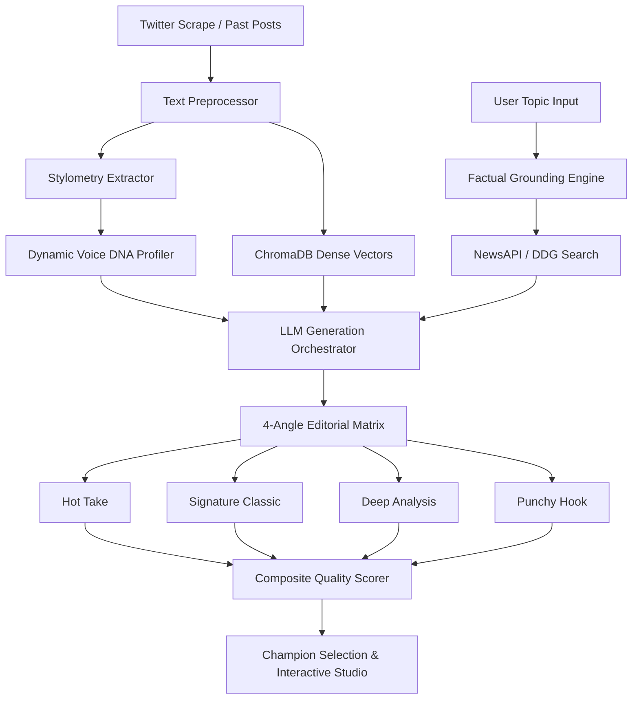

# 🪶 Tweet Like You

> **Universal Social Voice Cloner, Multilingual Stylometric Engine & Real-Time Editorial Matrix**

[](https://fastapi.tiangolo.com)
[](https://react.dev/)
[](https://vitejs.dev/)
[](https://ai.google.dev/)
[](https://www.trychroma.com/)
[](LICENSE)

**Tweet Like You** is an enterprise-grade AI engine that captures, quantifies, and clones individual writing voices for social media. Moving beyond generic LLM prompts, it calculates mathematical stylometrics (syntactic pacing, vernacular blending, lowercase frequency, capitalization bursts), retrieves true historical context using **ChromaDB dense vectors**, grounds generated content with **live web news**, and presents a structured **4-Angle Editorial Matrix** scored for viral potential and brand fidelity.

---

## ⚡ Key Capabilities

### 1. Mathematical Stylometry & Voice DNA
- Computes character and token distributions, punctuation velocity (exclamation points, ellipses, query density), capitalization bursts, and vocabulary richness (Type-Token Ratio).
- Quantifies syntactic rhythm and tone, formatting dynamic system prompts with strict stylistic negative constraints.

### 2. Bilingual & Vernacular Adaptation (Hinglish / Code-Switching)
- Automatically detects and replicates natural code-switching patterns (e.g. Hindi/Hinglish blends, colloquial phrases, sentence-ending particles).
- Preserves the authentic voice of multicultural and regional creators without sounding artificial or stilted.

### 3. Real-Time Factual Grounding Radar
- Integrates live web search and NewsAPI verification with anchor dates.
- Injects verified current affairs and contextual facts into generation prompts to eliminate temporal hallucinations.

### 4. 4-Angle Editorial Matrix
Instead of producing a single predictable output, the engine generates an editorial matrix across four distinct strategic angles:
- **Hot Take / Provocative**: High-energy, contrarian angle optimized for engagement and discussion.
- **Signature Classic**: Uncompromising adherence to the creator's authentic cadence and vocabulary.
- **Deep Analysis**: High-substance, thread-starting breakdown with structural pacing.
- **Punchy Hook**: Ultra-concise, scroll-stopping one-liner.

### 5. Composite Scoring & Champion Selection
Every candidate is evaluated on a multi-dimensional rubric:
$$\text{Score} = (0.40 \times \text{Stylometry}) + (0.30 \times \text{Virality}) + (0.30 \times \text{Relevance})$$
The top-performing draft is highlighted as the **Editorial Champion**.

### 6. Interactive Post-Processing & Transformations
- **Spicier**: Amplifies conviction, edge, and punch.
- **Hinglish Blend**: Infuses colloquial vocabulary and casual phrasing.
- **Shorten**: Tightens sentence economy for maximum scroll-stopping impact.
- **Post to X**: Direct 1-click intent URL integration.

### 7. Multi-User Workspaces & Persona Management
- Isolated workspaces per user account with separate persona sets.
- Built-in persona deletion with one-click cleanup of vector indices and profile configurations.
- Pre-configured demo accounts for immediate hands-on testing.

### 8. Executive UI (Light / Dark Mode)
- Built with a sleek, minimalist aesthetic (no tacky gradients or emoji clutter).
- Full Light Mode and Dark Mode support with smooth CSS variable transitions.
- Custom golden quill emblem branding and high-DPI favicon.

---

## 🏛️ System Architecture



---

## 📂 Repository Structure

```
Tweet Like You/
├── api.py                    # FastAPI REST backend (workspaces, personas, matrix generation)
├── app.py                    # Streamlit alternate interface
├── account_ingestor.py       # Account scraping & ChromaDB ingestion pipeline
├── baseline.py               # Zero-shot baseline generator
├── rag_baseline.py           # Few-shot vector RAG generator
├── stylometry.py             # Linguistic stylometry analysis & feature extraction
├── persona_profiler.py       # Voice DNA compiler & prompt generator
├── dynamic_prompt.py         # Dynamic prompt assembly with few-shot exemplar injection
├── ground.py                 # Factual grounding & live news verification engine
├── rerank.py                 # Multi-metric composite quality scoring
├── classifier.py             # Tweet categorization & tone classifier
├── config.py                 # Central configuration and paths
├── requirements.txt          # Python backend dependencies
├── .env.example              # Sanitized environment variable template
│
├── data/
│   ├── profiles/             # Pre-configured persona JSON profiles & system prompts
│   │   ├── beingsalmankhan_persona.json
│   │   ├── ravishastriofc_persona.json
│   │   ├── sama_clone_persona.json
│   │   └── ...
│   └── chroma_db/            # Local vector database storage
│
└── frontend/                 # React 19 + Vite modern client
    ├── public/               # Static assets (logo.png, favicon.png)
    ├── src/
    │   ├── App.jsx           # Main application interface
    │   ├── main.jsx          # React DOM entrypoint
    │   └── index.css         # Executive design system & theme tokens
    ├── package.json          # Node dependencies
    └── vite.config.js        # Vite dev server configuration
```

---

## 🚀 Getting Started

### Prerequisites
- **Python 3.10+**
- **Node.js 18+** and **npm**
- **Google Gemini API Key** ([Get free key](https://aistudio.google.com/app/apikey))
- **NewsAPI Key** (Optional for factual grounding, [Get free key](https://newsapi.org/register))

---

### 1. Clone the Repository

```bash
git clone https://github.com/your-username/tweet-like-you.git
cd tweet-like-you
```

---

### 2. Environment Configuration

Copy the example environment file:

```bash
cp .env.example .env
```

Open `.env` and configure your credentials:

```ini
# Core LLM
GEMINI_API_KEY=your_gemini_api_key_here

# Factual Grounding (Optional)
NEWS_API_KEY=your_news_api_key_here

# Runtime Options
LOG_LEVEL=INFO
USE_TF=0
```

---

### 3. Backend Setup

Create and activate a virtual environment:

```bash
# Windows (PowerShell)
python -m venv venv
.\venv\Scripts\Activate.ps1

# Linux / macOS
python3 -m venv venv
source venv/bin/activate
```

Install dependencies:

```bash
pip install -r requirements.txt
```

Start the FastAPI server:

```bash
python -m uvicorn api:app --port 8000 --reload
```

The API documentation is accessible at: `http://localhost:8000/docs`

---

### 4. Frontend Setup

Open a new terminal window:

```bash
cd frontend
npm install
npm run dev
```

The web application will launch at: **`http://localhost:3000`**

---

## 🔐 Pre-Configured Demo Workspaces

The platform comes with built-in multi-user workspaces. Click the **User / Workspace** button in the top navigation to switch accounts:

| Workspace | Email | Password | Pre-Loaded Personas |
|:---|:---|:---|:---|
| **Arjun (Creator)** | `demo@tweetlikeyou.com` | `demo123` | Salman Khan, Ravi Shastri (Vernacular & Sports) |
| **Sarah (Tech Founder)** | `founder@silicon.ai` | `founder123` | Sam Altman, Tech Critics, Film Analysts |

*You can also clone new voices dynamically into whichever workspace is currently active.*

---

## 🔌 API Endpoints Reference

| Method | Endpoint | Description |
|:---|:---|:---|
| `GET` | `/api/personas?user_email=...` | Retrieve all active personas filtered by workspace |
| `POST` | `/api/generate` | Generate the 4-Angle Editorial Matrix with real-time grounding |
| `POST` | `/api/transform` | Execute 1-click transformation (`spicier`, `hinglish`, `shorten`) |
| `POST` | `/api/clone` | Extract voice DNA from past posts and index into ChromaDB |
| `DELETE` | `/api/persona/{user_id}` | Purge persona configuration, style profiles, and vector embeddings |
| `POST` | `/api/auth/login` | Authenticate workspace user session |

---

## 🧪 Evaluation & Benchmark Results

The pipeline includes an automated evaluation suite (`evaluate.py`) measuring:
- **ROUGE-1, ROUGE-2, ROUGE-L**: Lexical and syntactic n-gram overlap with historical human tweets.
- **Stylometric Deviation**: Distance between target profile metrics and generated outputs.
- **Factual Fidelity**: Precision of grounded assertions versus real-time news anchors.

Run evaluations locally:

```bash
python evaluate.py
```

---

## 🛡️ License

This project is licensed under the **MIT License** — see the [LICENSE](LICENSE) file for details.

---

## 🤝 Contributing

Contributions, issues, and feature requests are welcome!
1. Fork the repository
2. Create your feature branch (`git checkout -b feature/AmazingFeature`)
3. Commit your changes (`git commit -m 'Add AmazingFeature'`)
4. Push to the branch (`git push origin feature/AmazingFeature`)
5. Open a Pull Request
